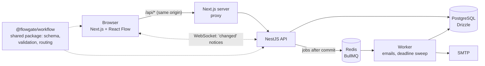

# Flowgate

**Turn email and paper approval processes into online workflows.** Admins build request
forms and draw the approval flow visually. Employees submit requests and follow them live.
Approvers decide from their inbox. The engine routes each request, enforces deadlines with
reminders and escalation, and keeps a full, append-only audit log.

> Live demo: _coming soon_ · Demo accounts: see [Run it locally](#run-it-locally)

## Features

- **Visual workflow builder** (React Flow): approval steps, conditions on form answers
  (`Cost > 1500`), parallel approvals (`any` or `all` must approve), deadlines.
  Problems are shown live while you draw, using the same checks the server runs.
- **Form builder:** text, long text, number, date and choice fields.
- **Versioning:** published versions never change. Requests keep the version they started with.
- **Inbox and request page:** approve, reject or send back with a comment. The requester
  fixes and resubmits, and the request returns to the step that sent it back.
- **Live updates** over WebSockets: pages refresh the moment something changes.
- **Deadlines:** reminders before a deadline, escalation to the assignee's manager after it.
  Emails go through a background queue.
- **Organizations, roles and invites:** admin / approver / employee. Every query is
  filtered by organization in the database, not only hidden in the UI.
- **Audit log** with CSV export, and a **dashboard** with approval times and bottlenecks.

## Architecture



| Part                | Tech                                                                                       |
| ------------------- | ------------------------------------------------------------------------------------------ |
| `apps/api`          | NestJS, TypeScript (strict), Drizzle ORM, PostgreSQL, Zod, BullMQ + Redis, Socket.IO       |
| `apps/web`          | Next.js (App Router), React, TanStack Query, Tailwind CSS, React Flow                      |
| `packages/workflow` | Pure TypeScript: definition schema, graph validation, condition evaluation, state machines |
| Tests               | Jest (engine unit tests, API tests on a real database), Playwright (acceptance)            |

Decisions are recorded in [`docs/decisions`](docs/decisions):
[0001 stack](docs/decisions/0001-stack.md) ·
[0002 engine](docs/decisions/0002-workflow-engine.md) ·
[0003 builder state](docs/decisions/0003-builder-state.md).

## Engine design

**Definitions vs runtime.** A workflow design (form + graph) is one immutable JSON document
per version. A database trigger rejects changes to published versions. Runtime data
(`requests`, `tasks`, `audit_events`) lives in normal indexed tables, because it is searched
and filtered.

**State machines.** Every status change goes through an explicit transition table:

```
request: in_progress → approved | rejected | changes_requested | cancelled
         changes_requested → in_progress (resubmit) | cancelled (withdraw)
task:    pending → approved | rejected | sent_back | skipped | escalated
```

**Routing.** Condition nodes are evaluated instantly against the form answers. Requests
only wait at approval steps. Before publishing, the graph is checked: one start, every
node reachable, no cycles, every condition has a default path, and rules only reference
real fields with matching types.

**Concurrency.** Each command runs in one transaction that first locks the request row
(`SELECT … FOR UPDATE`). Two approvers clicking at the same moment are applied one after
the other; the second sees the first's result and gets a clear 409 instead of corrupting
state. Tests fire simultaneous decisions to prove it. Emails and live notices are collected
during the transaction and sent only **after commit**.

**Timers.** A worker sweeps due tasks on an interval: it sends reminders and escalates
overdue tasks to the assignee's manager. Escalation uses the same locking, so it can't race
a last-second approval.

**Audit.** `audit_events` is append-only (a trigger blocks `UPDATE` and `DELETE`). Every
transition records who, when, from and to which status, and why.

## Run it locally

Needs Node 22+, pnpm 10 and Docker.

```bash
pnpm install
docker compose up -d                 # Postgres :5441, Redis :6380, Mailpit :1026 / UI :8026
cp apps/api/.env.example apps/api/.env
cp apps/web/.env.example apps/web/.env
pnpm db:migrate
pnpm --filter @flowgate/api db:reset # demo organization, people and sample workflows
pnpm dev                             # web http://localhost:3000, API http://localhost:4000
```

Demo accounts (password `flowgate-demo`):

| Account                             | Roles                                              |
| ----------------------------------- | -------------------------------------------------- |
| `alex@acme.test`                    | admin, approver: builds workflows, sees everything |
| `maria@acme.test`                   | approver: manager of Emma and Noah                 |
| `frank@acme.test`, `lena@acme.test` | approvers: Finance and Legal                       |
| `emma@acme.test`, `noah@acme.test`  | employees                                          |

Emails (invites, new tasks, reminders) land in Mailpit at http://localhost:8026.

## Tests

```bash
pnpm test        # engine unit tests + API tests against a real Postgres (flowgate_test)
pnpm test:e2e    # Playwright acceptance tests; needs the app running with the demo seed
pnpm lint && pnpm typecheck && pnpm format:check
```

CI (GitHub Actions) runs all of the above on every push and pull request.
